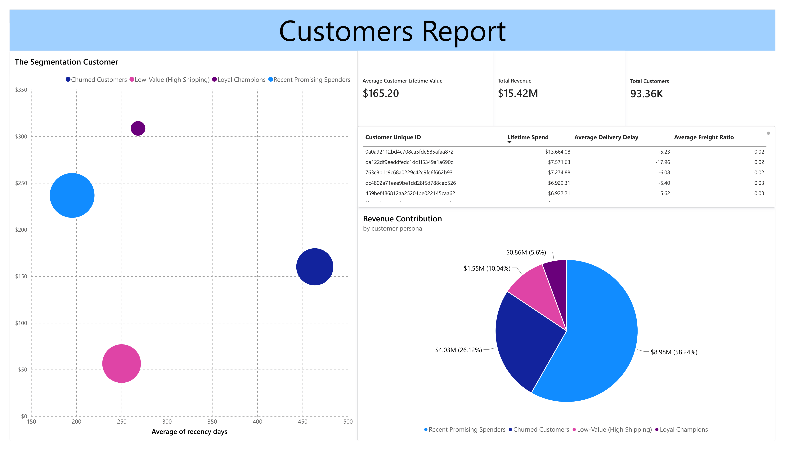

# E-Commerce Customer Retention & Logistics Analysis

**Executive Summary:**
Analyzed 93,000+ customer records from a Brazilian e-commerce database to identify drivers of customer churn and repeat purchases. Built an end-to-end pipeline (SQLite → Python → Power BI) that revealed a massive revenue leak driven by high shipping costs, and segmented the customer base to power targeted marketing campaigns.

## 📌 Business Problem
The company struggles with single-purchase customers and unoptimized logistics. The core objectives of this project were:
1. Identify what operational factors (e.g., delivery delays, freight costs) drive customer dissatisfaction.
2. Segment the customer base to find the most valuable repeat buyers.
3. Provide an actionable dashboard for the marketing team to target at-risk users.

## 🛠️ Methodology & Tools
* **Data Extraction & Engineering (SQLite):** Engineered features for Recency, Frequency, and Monetary (RFM) value, alongside logistic metrics like `delivery_delay` and `freight_ratio` using complex Common Table Expressions (CTEs).
* **Exploratory Data Analysis & Modeling (Python / Pandas / Scikit-Learn):** Addressed severe right-skew in financial data via log transformations. Applied K-Means clustering (using the Elbow Method for an optimal $k=4$) to segment customers based on behavioral traits.
* **Data Visualization (Power BI):** Designed an interactive executive dashboard with actionable tables for marketing outreach.

## 📊 Key Insights
* **The Freight Trap:** The "Low-Value" segment pays an average of **34.7%** of their total order value purely in shipping costs, completely disincentivizing repeat purchases.
* **The Retention Goldmine:** "Loyal Champions" represent a massive **58.24%** of total revenue despite being a smaller portion of the overall headcount.
* **Logistics Matter:** Single-purchase "Churned Customers" suffer from the highest average delivery delays, proving that poor fulfillment directly harms lifetime retention.



## 💡 Strategic Recommendations
1. **Targeted Subsidies:** Implement a localized free-shipping threshold for the "Recent Promising Spenders" segment to convert them into "Loyal Champions."
2. **Win-Back Campaigns:** Export the "Churned Customers" list from the Power BI dashboard and execute a targeted email campaign offering a one-time high-value discount to re-engage them.
3. **Seller SLA Enforcement:** Penalize third-party sellers who consistently miss the estimated delivery dates, as their logistical failures are directly causing platform-level customer churn.

## 📂 Repository Structure
```text
ecommerce-customer-churn-analysis/
├── README.md                           
├── sql/                                
│   └── 01_data_aggregation_cte.sql          
├── notebooks/                          
│   └── 02_rfm_kmeans_segmentation.ipynb     
└── dashboard/                          
    ├── ecommerce_dashboard.pbix             
    ├── ecommerce_dashboard.pdf
    └── dashboard_screenshot.png
